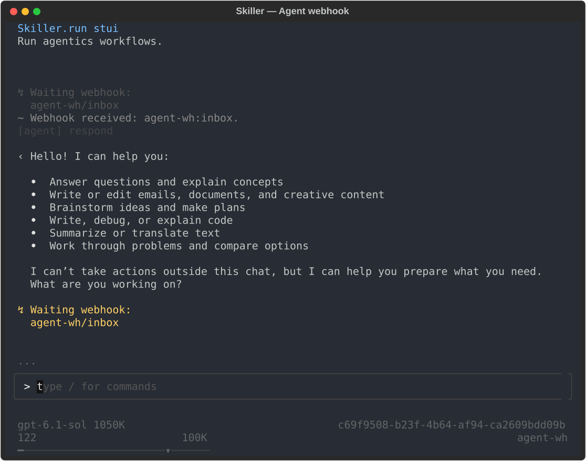

# Skiller

**Runtime for YAML-defined AI agents.**

Durable runs, persistent loops, terminal UI, tools, and multiple LLM providers.

[Website](https://skiller.run) · [Documentation](https://skiller.run/docs/getting-started/installation/) · [PyPI](https://pypi.org/project/skiller/)



## Why Skiller

- **Agents defined in YAML.** Combine agents, tools, deterministic steps, and external input in readable workflows.
- **Persistent executions.** Keep run state and history across process restarts. Wait for a message or webhook and continue the same run later.
- **Your models and tools.** Choose OpenAI-compatible, Codex, or Bedrock connections per agent, with configurable tools and operational guardrails—not a security sandbox.
- **Visibility from your terminal.** Chat with agents and follow their execution in STUI, or start runs, send tasks, and inspect events through the CLI.

## Get started

Install Skiller and open the terminal UI:

```bash
pipx install skiller
skiller
```

First-time setup guides you through connecting an LLM provider, then starts **Flows**, the built-in agent that helps you create workflows and custom agents.

[Installation guide](https://skiller.run/docs/getting-started/installation/) · [Meet Flows](https://skiller.run/docs/getting-started/your-first-agent/)

## Create your own agent

Define an agent that receives a task, responds, and waits for the next message:

```yaml
name: helper
description: "A helpful custom agent"
version: "0.1"
start: ask_user

steps:
  - wait_input: ask_user
    prompt: "Write a task."
    next: helper

  - agent: helper
    config:
      file: "~/.skiller/profiles/agent.helper.json"
    system:
      file: "./system.md"
    task: '{{output_value("ask_user").payload.text}}'
    tools:
      - shell
    next: ask_user
```

Save this as `helper/helper.yaml`. Follow [Create a custom agent](https://skiller.run/docs/demos/custom-agent/) to add the system prompt and tool profile. The profile inherits your configured provider and model.

## Run in STUI

The interactive terminal UI is the best way for people to work with agents: send tasks, follow tool calls, and read responses in one conversation.

From the directory containing `helper/`, open `skiller` and enter:

```text
/run @helper
```

## Run from the CLI

The CLI is designed for automation, scripting, and invocation by other agents. It uses the same runtime, workflow definitions, and persisted runs as STUI.

**1. Create a run.** From the directory containing `helper/`, start the agent:

```bash
skiller run @helper
```

The agent waits for input. Copy the returned run ID for the following commands.

**2. Send a task and wait for the response.** Use `--wait` to stay attached until the run finishes or reaches its next waiting state:

```bash
skiller input receive <run_id> --text "List the files in the current directory." --wait
```

Reuse the same run ID to send another task.

**3. Inspect the run.** Check its current state with `status` and read its persisted events, including responses and errors, with `logs`:

```bash
skiller status <run_id>
skiller logs <run_id>
```

## Trigger a task via webhook

A workflow can wait for an HTTP request instead of terminal input. This minimal flow receives a message, runs the agent, and waits for the next request:

```yaml
name: agent-wh
start: wait_task

steps:
  - wait_webhook: wait_task
    webhook: agent-wh
    key: inbox
    next: respond

  - agent: respond
    system: "Respond to the user's message clearly and concisely."
    task: '{{output_value("wait_task").payload.message}}'
    tools: []
    next: wait_task
```

The agent uses your global model configuration and exposes no tools. Follow the [webhook demo](https://skiller.run/docs/demos/agent-webhook/) to start the server, register the webhook, and launch the run. Then send a message using the registered secret in `WEBHOOK_SECRET`:

```bash
curl --fail-with-body -X POST http://127.0.0.1:8001/webhooks/agent-wh/inbox \
  -H 'Content-Type: application/json' \
  -H "X-Webhook-Token: $WEBHOOK_SECRET" \
  --data '{"message":"Hello! What can you help me with?"}'
```

Observe the response in STUI or inspect the run through the CLI. The HTTP response acknowledges delivery; it does not contain the agent's answer.

## Explore the demos

- [Create a custom agent](https://skiller.run/docs/demos/custom-agent/) — define its behavior, tools, and profile.
- [Automate a pull request](https://skiller.run/docs/demos/automate-a-pull-request/) — let an agent invoke a workflow to create a PR.
- [Trigger an agent with a webhook](https://skiller.run/docs/demos/agent-webhook/) — send a task over HTTP and observe the response.

## Documentation

- [Runtime](https://skiller.run/docs/configuration/runtime/) — database, logging, webhook server, and workflow search paths.
- [LLM providers](https://skiller.run/docs/configuration/supported-llm-apis/) — supported APIs, connections, credentials, and models.
- [Agent harness](https://skiller.run/docs/configuration/global-agent/) — profiles, model selection, context, loop limits, events, and debugging.
- [Harness tools](https://skiller.run/docs/tools/overview/) — available tools, configuration, and permission guardrails.

## Contributing

See the [development instructions](apps/instructions/skiller-dev.md) for setup and checks, and the [Runtime architecture](packages/skiller/docs/architecture/architecture.md) for implementation boundaries.

## License & disclaimer

Apache-2.0. See [LICENSE](LICENSE).

This project is provided "as is", without warranties of any kind. The authors and
contributors are not responsible for production incidents, data loss, service
interruptions, security issues, regulatory non-compliance, third-party integration
failures, or any direct or indirect damages resulting from its use.
